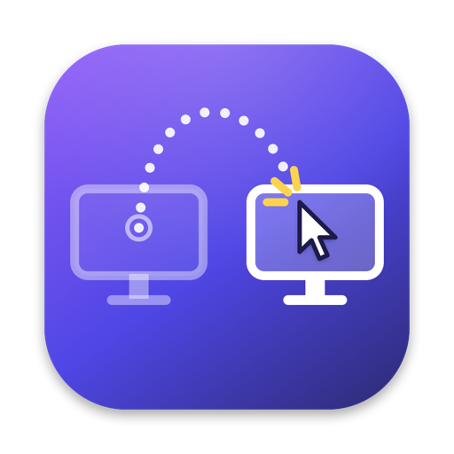

<p align="center">
  
</p>

<h1 align="center">Blink</h1>

<p align="center"><b>Teleport your mouse cursor between screens with a keyboard shortcut.</b><br>
A tiny, free menu bar app for macOS.</p>

<p align="center">
  <a href="https://github.com/pnborchert/blink/releases/latest/download/Blink.zip"></a>
</p>

<p align="center">or with Homebrew:&nbsp; <code>brew install --cask pnborchert/tap/blink</code></p>

---

Got two or three monitors and tired of dragging the mouse across all of them to find the cursor? Press <kbd>⌥ Tab</kbd> and the cursor **blinks** to your other screen — right back to where you left it — and the window there gets keyboard focus, so you can just keep typing.

It works like <kbd>⌘ Tab</kbd>, but for screens: hold <kbd>⌥</kbd> and tap <kbd>Tab</kbd> again to keep going. With three screens, <kbd>⌥ ⇧ Tab</kbd> blinks backward, so every screen is one keypress away.

I built this because every mouse-teleport tool I found was a paid app. Blink is small, fast and does one thing.

## Usage

| Shortcut | What it does |
| --- | --- |
| <kbd>⌥ Tab</kbd> | Blink forward (to the screen you used last, then the one before…) |
| <kbd>⌥ ⇧ Tab</kbd> | Blink backward |
| keep holding <kbd>⌥</kbd> + <kbd>← → ↑ ↓</kbd> | Blink to the screen in that direction |
| keep holding <kbd>⌥</kbd> + <kbd>1</kbd>…<kbd>9</kbd> | Blink to screen *n* |
| keep holding <kbd>⌥</kbd> + <kbd>esc</kbd> | Never mind — put the cursor back |

Let go of <kbd>⌥</kbd> and the front window on that screen gets focus. The arrow and number keys are only grabbed while you're mid-blink, so <kbd>⌥ ←</kbd> and friends keep working normally in your apps.

Don't like <kbd>⌥ Tab</kbd>? Click the menu bar icon → **Shortcut** → **Record New Shortcut…** and press whatever you like (<kbd>⌘ §</kbd>, <kbd>⌃ ⌥ Space</kbd>, …). Blinking backward is always the same plus <kbd>⇧</kbd>.

## Install

**Homebrew** (easiest — also gets you updates with `brew upgrade`):

```sh
brew install --cask pnborchert/tap/blink
```

**Download:** grab [Blink.zip](https://github.com/pnborchert/blink/releases/latest/download/Blink.zip), unzip it and move **Blink.app** to Applications. Blink isn't signed with a paid Apple developer account, so the first time macOS will refuse to open it: go to *System Settings → Privacy & Security* and click **Open Anyway** (or run `xattr -dr com.apple.quarantine /Applications/Blink.app`). Homebrew takes care of this for you.

**Build it yourself** (macOS 13+, Xcode or just the Command Line Tools):

```sh
git clone https://github.com/pnborchert/blink.git
cd blink
make install
```

### Permissions

Moving the cursor needs no permissions at all. To also **focus the window** on the other screen, Blink asks for *Accessibility* access on first launch. Say no and it still teleports the cursor, just without the focus part.

## Settings

Everything is in the menu bar icon:

- **Shortcut** — record your own, or turn on arrows/numbers without the Tab step
- **Cursor Lands At** — where you last left it on that screen (default), the screen center, or the center of the front window
- **Focus Window on Target Screen**, **Highlight Cursor After Blink**, **Show Screen Switcher While Holding** (a small ⌘Tab-style map of your screens), **Wrap Around at Last Screen**
- **Launch at Login**

Settings are saved to `~/.config/blink/config.json`. You can edit that by hand too — see [docs/config.md](docs/config.md) for all the options and the `--perform` command for scripting.

## Under the hood

Swift, AppKit, no dependencies, about 2,000 lines. Global shortcuts use Carbon's `RegisterEventHotKey` (so no keylogger-style permissions), the cursor jumps with `CGWarpMouseCursorPosition`, and window focus goes through the Accessibility API. Idle CPU is zero: nothing runs until you press the shortcut.

```
Sources/BlinkCore/   screen geometry, shortcut parsing, config (pure Swift, unit tested)
Sources/Blink/       the menu bar app
```

`make test` runs the tests, `make run` builds and launches from `dist/`, and `scripts/release.sh 1.1.0` cuts a release and updates the Homebrew tap. Ideas for what's next are in [ROADMAP.md](ROADMAP.md) — issues and PRs welcome.

## License

MIT
